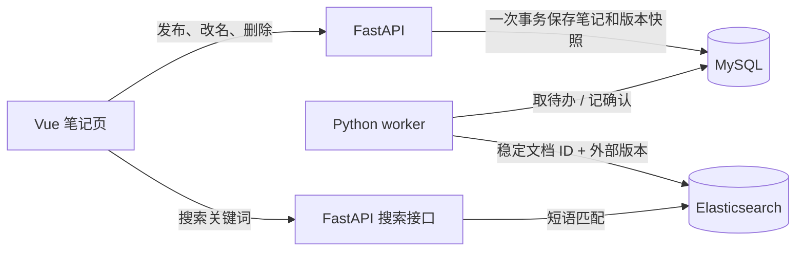

# 一页架构取舍 · 改过的标题何时能搜到

**一次改名。** 把《美团一面复盘》改为《字节一面复盘》时，API 锁定笔记行、递增版本，并把包含新标题的完整快照写入发件箱。MySQL 提交成功后详情就能看到新标题。worker 在事务外写索引，成功后确认待办。ES 刷新之后，读者才搜得到“字节”。这段可测的间隔是最终一致性的代价。

**数据少时为什么还单独做搜索？** 对两篇示例笔记，SQL 匹配标题、正文并优先返回标题命中，已经够用。单独的索引让查询和写入可以独立停启，也让项目能够验证恢复顺序。代价是多维护一个服务、多存一份数据，并承担短暂的检索滞后。中文查询按连续字符匹配，两级固定分数保证正文重复很多次也不会超过标题命中。

**搜索停机为什么不改查主库？** 停机期间的查询返回 503，页面提示“搜索暂时不可用，请稍后再试”。首页、详情、修改和删除继续访问 MySQL。把关键词查询临时转给业务库，会让搜索故障期间的负载转移到发布路径。验收用每个请求的 SQL 计数证明搜索故障没有触发这一回退，同时用详情请求的正计数核对仪表有效。

**一次投递为什么可能发生两遍？** 假设 Elasticsearch 已接收版本 4，而 worker 在确认待办前退出。重启后会再次投递版本 4。ES 只接受比当前版本更大的外部版本，重复结果可以安全确认。网络超时意味着结果未知，待办保留供重试。写入格式错误则保留错误原因，便于人工修正。

**删除后旧任务为什么无法复活笔记？** 删除写入更高版本的精简文档，例如版本 5 的 `deleted=true`。查询只返回存活笔记。等删除已对搜索可见，再重放版本 4 的编辑，ES 仍保留版本 5。保留标记需要存储空间，换来了对很晚才到的旧任务的防护。

可运行的证据在[真实服务故障测试](../backend/tests/integration/test_search_workflow.py)。查看处理结果时，先等事件确认，再刷新索引并按笔记 ID 查询，避免读到上一次刷新的结果。

一次本地 Compose 验收中，重启 Elasticsearch 后，查询探针用了 15.03 秒恢复成功响应。从这次成功响应起算，最终标题在 0.81 秒后可检索，删除结果在 0.83 秒后可见。故障期间，对已有词和无匹配词的两次查询都返回 503，各执行 0 条 SQL。上述数字来自小规模种子数据的单次运行，30 秒恢复验收窗口从探针成功时开始。
