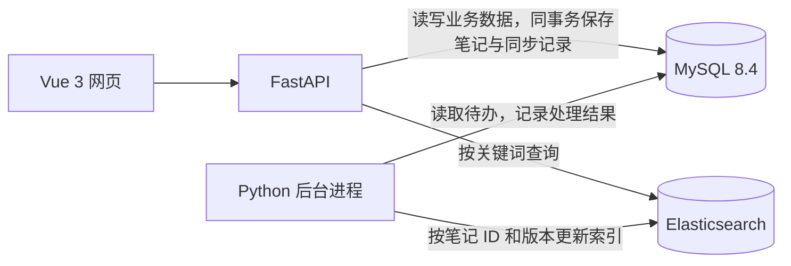

# 技术方案 · 图文笔记社区与笔记搜索

| 功能编号 | 日期 | 状态 | 依据 |
| --- | --- | --- | --- |
| `001-note-community-search` | 2026-11-21 | 待实现 | [功能规格](./spec.md) · [产品需求](../../PRD.md) |

**一次编辑有两个完成时刻。** MySQL 提交成功时，作者就能在详情页看到新标题。后台把这次修改送到 Elasticsearch，索引刷新后，读者才能用新标题搜到它。两者之间允许有短暂延迟。下面以这条写入路径为主线说明实现和验收。

## 1. 架构与选型

| 部分 | 方案与取舍 |
| --- | --- |
| 页面与 API | Vue 3、Vite、Python 3.12、FastAPI。网页同源访问 `/api`。首页、详情和发布页参考 PRD 中的旧版 Vue 页面，收藏及搜索按本项目的接口实现 |
| 业务数据 | MySQL 8.4 / InnoDB，使用 SQLAlchemy 2 和 Alembic。详情、首页和收藏都读已提交的业务数据。固定的小图样本先存 MySQL 的独立图片表，便于一次提交图文、一次备份。图片规模增长时可把内容移到对象存储 |
| 搜索 | 单节点 Elasticsearch 9.x，Python 客户端使用相同主版本，实施时锁定具体版本。索引只保存查询和结果卡片需要的字段。单节点开发索引配置一个主分片、零副本 |
| 后台同步 | API 和 worker 共享一套 Python 代码，作为两个进程运行。用 MySQL 中的待办表向搜索传递变更，称为**事务发件箱（transactional outbox）**。本地只有一个下游消费者，一张表就能同时提供可靠交付、失败追踪和按事件重放 |

如果需求只有少量笔记的关键词查找，MySQL 的参数化查询配合标题命中优先排序就能交付。这里选择独立索引，是为了让搜索可独立中断和恢复，并检验两份数据如何保持一致。代价是多运行一个服务、增加同步延迟，还要处理重试与删除。把这些成本作为面试取舍说明的出发点。

## 2. 数据模型和用户接口

| 表 | 关键字段与约束 |
| --- | --- |
| `users`、`sessions` | 唯一用户名、密码哈希。会话关联用户，保存随机令牌的摘要和过期时间。登录发 HttpOnly、SameSite=Lax 的 Cookie，退出使服务端会话失效 |
| `notes` | `id, author_id, title, body, published_at, version, deleted_at`。新笔记版本为 1。编辑与删除锁定同一行并递增版本，ID 永不复用。首页过滤已删除笔记，按 `published_at DESC, id DESC` 排序 |
| `note_images` | 每张图记录笔记 ID、展示次序、类型和图片内容。仅图片接口读取二进制数据。第一张图作为封面。发布和编辑时校验文件类型与大小，笔记、图片变更和待办同事务提交 |
| `favorites` | 主键为 `(user_id, note_id)`。重复收藏返回成功，取消收藏可重复执行。列表只关联未删除的笔记，按登录用户过滤 |
| `search_outbox` | 每行保存事件 ID、笔记 ID、版本、不可变的索引快照、状态、尝试次数、下次可执行时间和最近错误。唯一键 `(note_id, version)`，按状态、可执行时间和事件 ID 取待办。完成的行保留供本地复盘 |

以下路径均以 `/api` 为前缀。后端从会话取得用户身份，作者校验在写事务内完成。

| 接口 | 约定 |
| --- | --- |
| `POST /sessions`、`DELETE /sessions/current`、`GET /me` | 登录、退出、读取当前账号。需要登录的写操作在会话无效时返回 401 |
| `POST /notes`、`PATCH /notes/{id}`、`DELETE /notes/{id}` | 发布、编辑、删除。发布提交标题、正文和至少一张图片。编辑时省略图片表示保留，提交图片表示替换整组。其他用户修改或删除返回 403，已删或不存在的笔记返回 404 |
| `GET /notes`、`GET /notes/{id}`、`GET /notes/{id}/images/{image_id}` | 首页卡片、详情和图片。图片必须属于指定且仍可见的笔记。删除提交后，原详情和图片链接均返回 404 |
| `PUT /me/favorites/{note_id}`、`DELETE /me/favorites/{note_id}`、`GET /me/favorites` | 添加、取消、列出自己的收藏。添加时确认笔记仍可见，数据库唯一键保证两个页面并发收藏也只产生一条记录 |
| `GET /search?q=美团` | 直接从索引返回 `items`，每条含笔记 ID、标题、封面地址与发布时间。正常零匹配返回 200 和空数组。搜索不可用返回 503 和稳定的业务码 `SEARCH_UNAVAILABLE` |

## 3. 从保存到可搜索

1. **在同一个事务内记下两件事。** 编辑笔记时校验作者并锁住笔记行。假设当前版本为 3，修改标题、把版本增至 4，再写一条版本 4 的完整索引快照。全部提交后 API 才返回成功。任一步失败都回滚。删除同理，但快照只含笔记 ID、版本和删除标记。
2. **后台按至少一次交付。** 一个 worker 每 250 毫秒查看到期的待办，在数据库事务外访问搜索服务。索引确认成功后才将待办标为完成。连接失败、超时或临时拒绝时记录错误并退避重试，间隔从 0.5 秒增长到最多 2 秒。进程在写索引后、确认待办前退出时，该行仍可在重启后重投。映射或快照格式错误单列为需修正的失败，保存原因及原事件。
3. **由索引比较版本。** 每篇笔记使用固定的文档 ID，通过索引 API 写入快照，并传入业务版本和 `version_type=external`。只有传入版本严格大于已存版本才会写入。对于这个索引操作，只有明确的版本冲突 `version_conflict_engine_exception` 才表示该版本已经处理或已被更新版本取代，可以结清待办。写入超时按结果未知处理，保留重试。[Elasticsearch 外部版本](https://www.elastic.co/docs/api/doc/elasticsearch/operation/operation-index)
4. **删除也写一份有版本的文档。** 若版本 5 是删除，索引中保留 `deleted=true` 的精简文档，并去掉标题和正文。所有搜索过滤 `deleted=false`。即使版本 4 的改名任务很久以后才重放，也无法覆盖版本 5。第一版持续保留删除标记。本地若需重建索引，可暂停写入和消费，从 MySQL 导出每篇笔记的当前版本（含已删除记录），重建后再恢复消费和写入。

## 4. 中文搜索与故障隔离

worker 在首次投递前按固定映射初始化索引。搜索尚未就绪时保留待办并重试。存活文档显式写入 `deleted=false`。映射将 `note_id` 设为 `long`、`published_at` 设为 `date`、`deleted` 设为 `boolean`，标题和正文均为带位置的 `text`。排序使用业务字段 `note_id`。

- **分词。** 标题和正文使用同一个自定义分析器，索引和查询都用 `ngram` tokenizer，`min_gram=max_gram=1`，保留字符位置。查询去除首尾空白后用 `match_phrase`、`slop=0` 查连续字符。“美团”能命中“美团一面”，不命中“美食团购”。这套规则适合短中文关键词，成本是正文产生较多索引项。[ngram tokenizer](https://www.elastic.co/docs/reference/text-analysis/analysis-ngram-tokenizer) · [短语匹配](https://www.elastic.co/docs/reference/query-languages/query-dsl/query-dsl-match-query-phrase)
- **排序。** 在标题和正文上分别做短语匹配，用 `constant_score` 给两个条件固定的 2 分和 1 分，放入 `dis_max` 并设 `tie_breaker=0`。查询必须匹配其中至少一个条件。命中标题始终排在仅命中正文之前，即使正文重复关键词很多次。相同分数按发布时间、笔记 ID 倒序排列，每篇笔记最多一个索引文档。[固定得分](https://www.elastic.co/docs/reference/query-languages/query-dsl/query-dsl-constant-score-query) · [取最高得分](https://www.elastic.co/docs/reference/query-languages/query-dsl/query-dsl-dis-max-query)
- **前端状态。** 空查询提示输入关键词。成功且 `items=[]` 时显示“没有找到相关笔记”。搜索连接失败、请求超时或分片未能完整返回时，API 返回 503，页面显示“搜索暂时不可用，请稍后再试”。关闭部分结果，检查响应的超时标记。搜索请求设置 2 秒客户端超时，关闭客户端自动重试，由用户再次查询。
- **隔离。** 搜索处理函数仅依赖搜索客户端。业务写入、首页及详情仅依赖 MySQL。API 启动、笔记路由就绪和示例账号登录均独立于搜索健康状态。索引保存卡片所需信息，返回命中结果无需逐条查主库，搜索故障时也不在主库执行替代查询。

## 5. 本地运行与验收

拟用 Docker Compose 提供 `web`、`api`、`worker`、`mysql` 和 `search` 五个服务。前端同源代理 API。迁移和两个示例账号在启动说明中有独立步骤，种子数据可重复装载。API 与 worker 共用后端镜像，搜索服务可单独停启。单节点索引刷新间隔显式设为 1 秒。

本地测试统一设置 **`SYNC_TIMEOUT_SECONDS=30`**。这是小规模固定数据集的验收上限。正常变更从保存成功的响应起计时，恢复测试从目标索引首次成功响应探测查询起计时。使用单调时钟，每 250 毫秒轮询真实搜索接口，并将每次请求的超时限制在剩余预算内。记录实际耗时、事件 ID、版本与最后结果，超时即失败。索引确认写入与查询可见之间隔着一次刷新。[Elasticsearch 索引刷新](https://www.elastic.co/docs/reference/elasticsearch/rest-apis/refresh-parameter)

| 验收目标 | 实施后的验证方式 |
| --- | --- |
| US1、US4 · 作者权限与收藏 | 开两个独立会话，验证作者编辑后详情立即更新、非作者写入 403、退出后写入 401。并发提交两次收藏，通过列表和数据库唯一键核对只有一条。取消或删除后刷新列表 |
| US2 · 关键词匹配与编辑 | 通过真实索引装载规格里的 A、B 两篇笔记。断言标题命中优先，再改名核对新旧关键词的结果 ID。补测单字、多字、非连续字符及正文重复命中，防止排序随词频变化 |
| US3 · 搜索中断 | 正常搜“火山”应得到 200 和空列表。执行 `docker compose stop search`，搜“火山”和已知命中词均应得到 503。此时发布、改名两次、浏览和删除仍须成功。按请求 ID 检查 SQL 跟踪，确认两次查询均未执行笔记搜索 SQL |
| US3 · 恢复与重放 | 执行 `docker compose start search`。索引就绪后等待最终标题可搜，再通过本地测试入口把第一次改名的原快照送入实际写索引函数两次。每次等待处理完成并刷新索引，再断言最终词只返回该 ID 一次、旧词不返回它 |
| US3 · 删除后重放 | 先确认原详情已返回 404。恢复搜索后，等删除事件完成，刷新索引，确认删除标记已生效且公开查询中已无该笔记。再重放删除前的更新，等待处理完成并再次刷新。用新旧词搜索，结果都不能包含该 ID |
| SC-002、SC-003 · 中途退出 | 在集成测试中让 worker 写索引成功后、确认待办前退出。重启后应重新处理该事件并结清待办。在统一超时内检查搜索可见、结果无重复，以及待办状态和耗时 |

后端采用 pytest，接口与故障测试使用真实 MySQL 和 Elasticsearch。浏览器验收另检查健康零结果与停服错误的两种中文提示。重放通过本地测试入口指定历史事件 ID，不对外提供 HTTP 操作接口。测试使用独立数据卷和索引，避免改变开发者的笔记。

## 6. 实施顺序与交接

| 顺序 | 计划位置 | 本步完成的判断依据 |
| --- | --- | --- |
| 1. 用户与笔记 | `backend/app/`、`backend/migrations/`、`frontend/src/` | 两个账号能走通发布、浏览、编辑、删除与收藏，覆盖 FR-001 至 FR-004 |
| 2. 笔记同步与查询 | `backend/app/search/`、`backend/app/worker.py` | 保存和待办同事务提交，真实索引上的中文匹配、排序和搜索状态满足 FR-005、FR-006 |
| 3. 故障与交付 | `backend/tests/integration/`、根目录 Compose 配置和启动说明 | 可独立停启搜索，重放编辑和删除前的任务，覆盖 FR-007、FR-008。记录验收耗时，随实作核对本页架构图，交付一页取舍说明，完成 SC-001 至 SC-004 |
